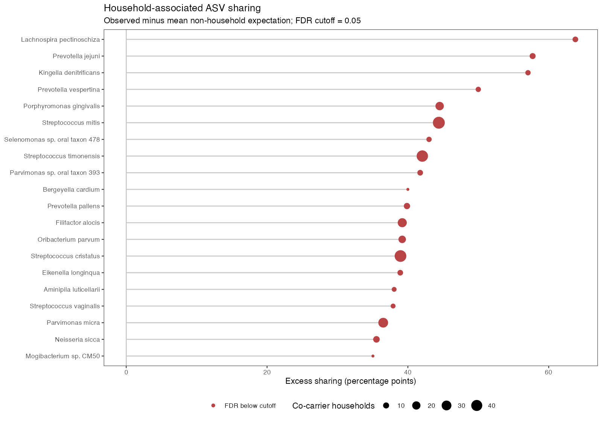
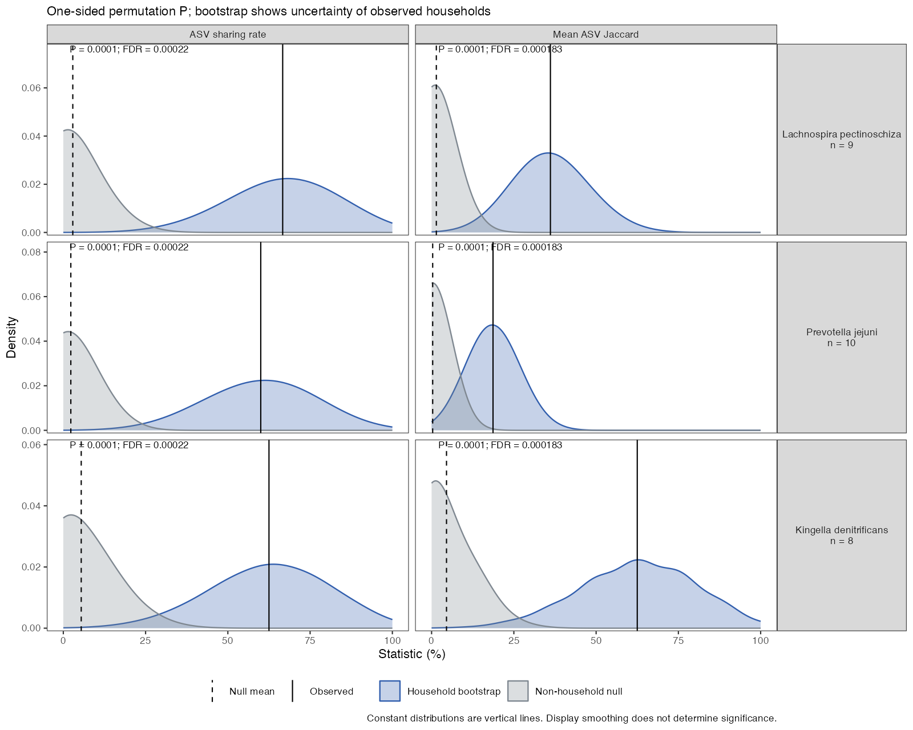

# FAMasv

**基于精确 ASV 的物种级家庭共享分析。**

[English README](README.en.md) · [完整示例](inst/examples/run_oral_example.R) · [示例数据](inst/extdata/README.md)

FAMasv 对一种组织的家庭配对数据计算 ASV 共享率和物种内 Jaccard 相似度，
通过非家庭随机配对估计背景，输出超额共享、P 值、FDR 和批量图表。



## 安装

需要 R ≥ 4.1.0、ggplot2 ≥ 3.4.0。phyloseq 仅用于可选的输入转换接口。

### 从 GitHub 源码文件夹安装

在仓库页面选择 **Code → Download ZIP**，解压后，在 R 或 RStudio 中将工作目录
设为包含 `DESCRIPTION`、`NAMESPACE` 和 `R/` 的文件夹，然后运行：

```r
install.packages("remotes") # 未安装时运行一次
remotes::install_github("callAgene/FAMasv", dependencies = NA, upgrade = "never")
library(FAMasv)
```

### 从 R 源码安装包安装

如果另外下载了 `FAMasv_0.3.0.tar.gz`，在该文件所在目录运行：

```r
install.packages("ggplot2") # 已安装可跳过
install.packages("FAMasv_0.3.0.tar.gz", repos = NULL, type = "source")
library(FAMasv)
```

GitHub 的 **Download ZIP** 源码压缩文件和 R 的 `.tar.gz` 安装包是两种不同格式，
请分别使用上面的对应安装方式。

## 快速运行

包内只有一套示例：**去标识化真实口腔数据**，包含 50 个 PD-HC 家庭、100 个样本、
10,111 条 ASV、508 个注释分类单元。它不是人工模拟数据。

```r
library(FAMasv)
input_dir <- system.file("extdata", package = "FAMasv")
input <- read_famasv(file.path(input_dir, "counts.csv"),
                    file.path(input_dir, "metadata.csv"),
                    file.path(input_dir, "taxonomy.csv"))
parameters <- famasv_parameters(
  exclude_unclassified = FALSE,
  n_permutations = 10000,
  n_bootstrap = 10000
)
result <- run_famasv(input$counts, input$metadata, input$taxonomy, parameters)
selected <- select_famasv_species(result, significant_only = FALSE, top_n = 6)
export_famasv(result, "results_preview", species = selected$Species)
```

示例已按原始 species 层级注释筛选，因此设置 **`exclude_unclassified = FALSE`**。
部分明确注释的分类单元在完整名称中保留了上级 `norank` 前缀，再按完整名称
过滤会误删这些记录。自己的数据应根据实际注释规则设置。

## Data Inputs：输入行列格式

每次只输入一种组织的数据，无需组织字段。以下尺寸均不含表头行。

| 文件 | 行 | 列 | 示例尺寸 |
|---|---|---|---|
| [counts.csv](inst/extdata/counts.csv) | 一条 ASV | asv_id，后续每列一个样本的 reads | 10,111 × 101 |
| [metadata.csv](inst/extdata/metadata.csv) | 一个样本 | sample_id、family_id、group | 100 × 3 |
| [taxonomy.csv](inst/extdata/taxonomy.csv) | 一条 ASV 注释 | asv_id、species | 10,111 × 2 |

### 计数表：部分实际行列

| asv_id | ORAL_S0085 | ORAL_S0088 |
|---|---:|---:|
| ORAL_A00001 | 0 | 45 |
| ORAL_A00002 | 35 | 0 |
| ORAL_A00003 | 25 | 0 |

必须使用非负整数 reads，不能使用相对丰度或 CLR。读取后 ID 列变为行名，
得到 **10,111 × 100** 的数值矩阵。ASV ID 必须在所有样本间对应同一条精确序列。

### 元数据：两个完整家庭

| sample_id | family_id | group |
|---|---|---|
| ORAL_S0077 | ORAL_F050 | HC |
| ORAL_S0085 | ORAL_F050 | PD |
| ORAL_S0088 | ORAL_F022 | HC |
| ORAL_S0097 | ORAL_F022 | PD |

相同 family_id 表示原家庭成员。每个家庭必须恰好一名 PD、一名 HC；缺失一方
时记录并排除，同组重复时会报错。其他分组名通过 `group_labels` 指定。
额外元数据列不会作为协变量使用。

### 分类注释表

| asv_id | species |
|---|---|
| ORAL_A00001 | Prevotella melaninogenica |
| ORAL_A00002 | Selenomonas sp. oral taxon 478 |
| ORAL_A00003 | Actinomyces graevenitzii |

物种名相同的 ASV 合并分析。三个表按 ID 匹配，不要求行顺序一致；样本和 ASV
的 ID 集合必须完全对应，不能重复，也不要添加 Excel 行号列。

自己的 CSV 可直接替换输入路径；TSV 增加 `sep = "\t"`。已有单组织 phyloseq
对象可使用 `famasv_from_phyloseq()`，转换后检查完整物种名和分组标签。

## Modification Guide：参数和出图

| 参数 | 默认值 | 含义 |
|---|---:|---|
| detection_count | 1 | ASV 存在所需最少 reads |
| minimum_shared_asvs | 1 | 判为共享所需相同 ASV 条数 |
| minimum_codetected_families | 5 | 双方携带物种的最少家庭数，至少为 3 |
| n_permutations | 10000 | 非家庭随机重配次数 |
| n_bootstrap | 10000 | 家庭重采样次数，0 表示关闭 |
| random_seed | 20260825 | 置换基础种子 |
| bootstrap_seed | 20260908 | bootstrap 基础种子 |
| fdr_cutoff | 0.05 | 严格使用 FDR < 阈值 |
| exclude_unclassified | TRUE | 排除包含未分类标记的名称；本示例需设 FALSE |

`detection_count = 2` 是至少 2 reads；`minimum_shared_asvs = 2` 是至少两条不同
的相同 ASV，两者不同。本示例非零计数最小值为 2，存在阈值 1 和 2 得到同样结果。

```r
# 全部正式检验物种：总览、分页和每物种单图
export_famasv(result, "results_all", species_per_page = 4,
              formats = c("pdf", "png"), per_species = TRUE)

# 显著物种
export_famasv(result, "results_significant", significant_only = TRUE)

# FDR 显著、超额共享至少 10 个百分点，最多 10 个物种
selected <- select_famasv_species(result, significant_only = TRUE,
                                  min_excess = 0.10, top_n = 10)
if (nrow(selected) > 0) {
  export_famasv(result, "results_filtered", species = selected$Species)
}

# 指定物种，返回可修改的 ggplot 对象
p <- plot_famasv_species(result,
  c("Lachnospira pectinoschiza", "Prevotella jejuni"))
ggplot2::ggsave("selected_species.pdf", p, width = 10, height = 6)
```



灰色为非家庭置换背景，蓝色为家庭 bootstrap，黑实线为观测值，黑虚线为背景均值。
图中选择了超额共享最高的三个分类单元，保留完整分析得到的 FDR。

支持 PDF、PNG、TIFF、SVG。`per_species = FALSE` 可关闭单物种图。
总览默认前 30 个物种，`plot_famasv_landscape(result, top_n = NULL)` 展示全部。
筛选画图不会重新计算 P 值或 FDR；可以重新读取结果 RDS 后换物种出图。
每次建议使用新输出目录；`overwrite = TRUE` 不删除旧目录中未覆盖的文件。

## Key Outputs：输出文件

- `tables/`：全部物种结果、筛选结果、逐家庭观测值和输入/配对/置换核查表。
- `figures/`：共享与 Jaccard 总览、分页图及每物种单图。
- `famasv_result.rds`：包括统计结果、置换及 bootstrap 分布。
- `parameters.R`、`sessionInfo.txt`、`manifest.csv`：参数、版本及文件清单。

选择部分物种时仍保留完整结果表和总览。无显著物种时仍可正常导出。

## Methodology：分析方法

对每个物种，仅纳入原家庭中双方都携带它的家庭。例如 46 个家庭中只有 7 个
符合条件，背景只使用这 7 名 PD 和这 7 名 HC。每次一对一重配，HC 不重复使用，
并排除全部原家庭匹配；不同次置换可重复出现相同重配方案。

计算共享指定数量相同 ASV 的家庭比例，以及物种内 ASV 集合的平均 Jaccard。
超额共享为实际值减去置换背景的**均值**。单侧 P 值为
`(1 + sum(null >= observed)) / (B + 1)`，两项指标分别在全部正式检验物种中进行
BH 校正。Bootstrap 用于展示观测值的不确定性，不参与置换 P 值计算。

